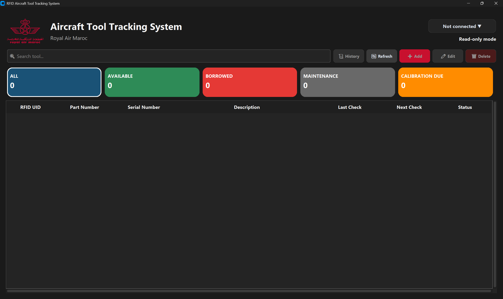
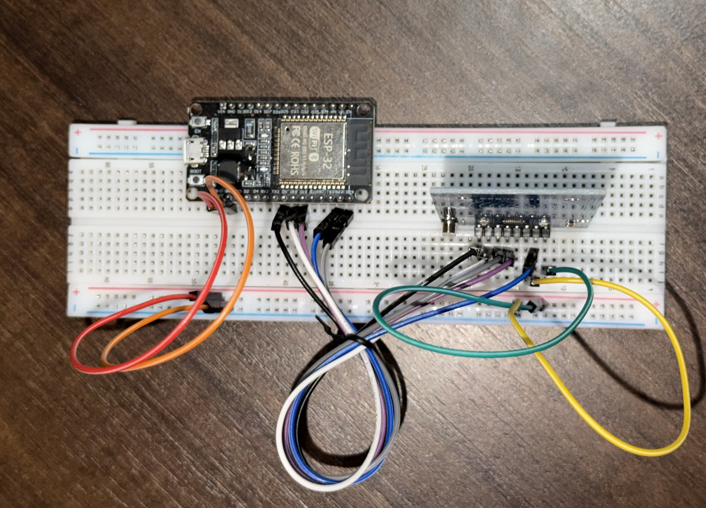

# RFID Aircraft Tool Tracking System

This project is an academic prototype developed during my engineering internship at Royal Air Maroc. Its purpose is to show how RFID technology can be used to identify aircraft tools, track their availability, and keep a clear history of check-out and return operations.



The complete system connects four main parts:

- an ESP32 with an MFRC522 RFID reader;
- a PHP API running on a local XAMPP server;
- a MySQL database;
- a Python desktop application built with CustomTkinter.

## What the system can do

- Read an RFID tag and send its UID to the API.
- Add, edit, search, and delete tools.
- Check out and return a tool using an employee number.
- Display the current tool status, including availability, maintenance, and calibration states.
- Keep a history of RFID scans and tool transactions.
- Provide local Storekeeper, Supervisor, and Administrator profiles protected by demo PINs.
- Keep the application visible in read-only mode after logout.

## Access control

- Without signing in, users can only view, search, filter, and refresh the tool list.
- Storekeepers and Supervisors can view tool history, manage tools, and confirm RFID check-out or return operations.
- Administrators can view tools and their history, but cannot add, edit, delete, or confirm transactions.

These permissions are part of the demonstrator. The local PINs are not intended to replace a production authentication system.

## How it works

1. The MFRC522 reader detects an RFID tag.
2. The ESP32 sends the tag UID to `scan_tool.php` through the local Wi-Fi network.
3. The PHP API checks the tool in MySQL and records the scan.
4. The desktop application retrieves the scan and displays the matching tool.
5. The user can confirm a check-out or return operation with a registered employee number.
6. The API updates the tool status and keeps the transaction in the history.

## Project structure

```text
aircraft-tool-traceability-rfid/
|-- API/          PHP endpoints and MySQL connection
|-- Arduino/      ESP32 and MFRC522 firmware
|-- Database/     MySQL installation schema
|-- Desktop_App/  Python desktop application
|-- Documentation/ README images
|-- LICENSE       Usage and copyright terms
|-- requirements.txt
`-- README.md
```

## Hardware

- ESP32 development board
- MFRC522 RFID reader
- RFID cards or tags
- USB cable
- Computer running Apache, PHP, and MySQL with XAMPP



### MFRC522 connections

| MFRC522 pin | ESP32 pin |
|---|---:|
| SDA / SS | GPIO 5 |
| SCK | GPIO 18 |
| MOSI | GPIO 23 |
| MISO | GPIO 19 |
| RST | GPIO 22 |
| 3.3V | 3.3V |
| GND | GND |

## Software requirements

- Windows 10 or 11
- Python 3
- XAMPP with Apache, PHP, and MySQL
- Arduino IDE
- ESP32 board support for Arduino IDE
- `MFRC522` Arduino library

The Python packages are listed in `requirements.txt`.

## Configuration

The repository does not contain my Wi-Fi password, database password, or private network address. These fields are intentionally left empty and must be filled locally before running the project.

### 1. Prepare the database

Start Apache and MySQL from XAMPP, then import:

```text
Database/rfid_aircraft_tools.sql
```

The SQL file automatically creates the `rfid_aircraft_tools` database and all required tables. It does not add employees, tools, scans, or transactions.

Before testing a check-out operation, add at least one test employee to the `employees` table. The employee number entered in the desktop application must already exist in this table.

### 2. Configure the PHP API

Copy the content of the `API` folder to:

```text
C:\xampp\htdocs\rfid_api
```

Open `API/connect.php` and fill in the four empty values:

```php
$host = "";      // MySQL server address
$user = "";      // MySQL username
$password = "";  // MySQL password
$database = "";  // Use rfid_aircraft_tools after importing the SQL file
```

When the configuration is correct, the API should be available at:

```text
http://localhost/rfid_api
```

Open the following page to check the database connection:

```text
http://localhost/rfid_api/test_db.php
```

### 3. Configure the ESP32

Open:

```text
Arduino/RFID_Tool_Tracking/RFID_Tool_Tracking.ino
```

Fill in the empty configuration fields at the beginning of the file:

```cpp
const char* ssid = "";       // Wi-Fi name
const char* password = "";   // Wi-Fi password
const char* serverURL = "";  // Full URL of scan_tool.php
```

For the ESP32, `serverURL` must use the local IP address of the computer running XAMPP, not `localhost`. The ESP32 and the computer must also be connected to the same network.

After filling in these values, connect the ESP32, select the correct board and port in Arduino IDE, and upload the sketch.

#### Optional: use the sketch in VS Code

The sketch works without these steps when it is opened in Arduino IDE. If VS Code shows false errors for ESP32 or MFRC522 header files, run the task `Arduino: Configure ESP32 IntelliSense`. The task uses `Arduino/configure-intellisense.ps1` to generate the local compilation information expected by the Microsoft C/C++ extension.

The generated files are stored in `.build/`. They can be large, are specific to each computer, and are ignored by Git. Run `Arduino: Verify ESP32 sketch` when you also want to compile the sketch from VS Code.

### 4. Configure the desktop application

The default API address is stored in `Desktop_App/config.py`:

```python
API_URL = "http://localhost/rfid_api"
```

Keep this value when the desktop application and XAMPP run on the same computer. Change it only if the API is hosted at another address.

## Install and run the desktop application

Open PowerShell in the project folder and run:

```powershell
cd Desktop_App
python -m venv .venv
.\.venv\Scripts\Activate.ps1
python -m pip install -r ..\requirements.txt
python main.py
```

Before starting the application, make sure Apache and MySQL are running and that the database connection works.

## Local demonstration workflow

Use this order for a complete local demonstration:

1. Start Apache and MySQL in XAMPP.
2. Open `http://localhost/rfid_api/test_db.php` and check the database connection.
3. Add a test employee to the `employees` table.
4. Start the Python desktop application and sign in with one of the demo profiles.
5. Register a test tool with its RFID UID.
6. Connect the ESP32 and open the Serial Monitor if needed.
7. Scan the registered RFID tag.
8. Confirm a check-out or return and verify the updated status and history.

## Security notes

- Do not commit real Wi-Fi credentials, database passwords, private IP addresses, or personal employee data.
- Keep the configuration fields empty in any shared version of the project.
- The profile PINs are only used for this demonstrator and are not production authentication.
- Do not upload internal Royal Air Maroc documents or a database export containing real operational data.

## Project limits

This is a local academic demonstrator, not an industrial aviation system. It uses a prototype RFID reader, a local server, simple profile authentication, and a limited test environment. It is not connected to the operational information system of Royal Air Maroc and should not be used for real maintenance operations.

## License

Copyright (c) 2026 Ziad (XIAD00).

This project is licensed under the **GNU General Public License v3.0**.

You are welcome to fork, study, modify, and redistribute the project under these conditions:

- keep the original copyright and license notices;
- clearly state the changes you made;
- make the complete source code available when redistributing the project;
- release modified or derived versions under the same GPLv3 license.

If you publish a modified version on GitHub, please use the **Fork** feature so the connection to the original project and its author remains visible. The complete legal terms are available in the `LICENSE` file.
